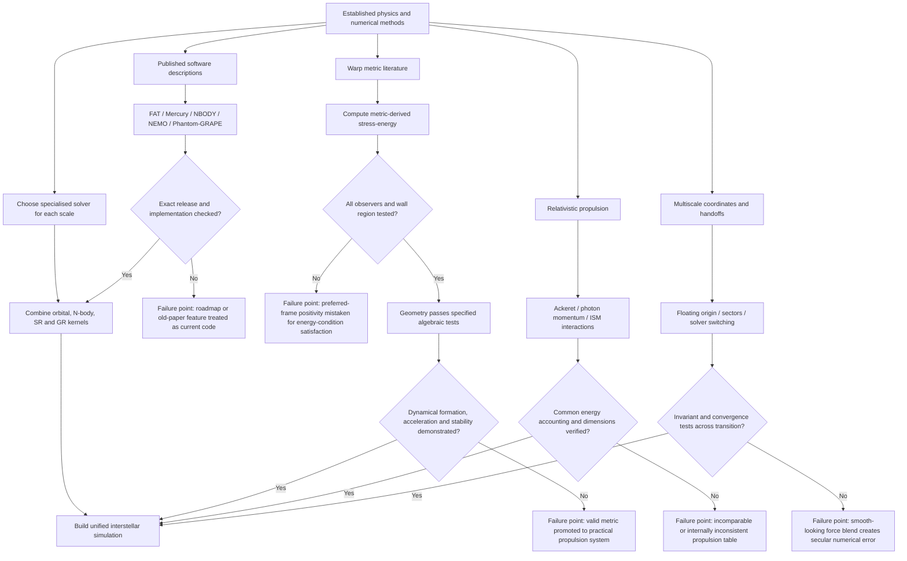

## Publication timeline, argument structure and primary sources

The chronology helps explain several errors: the uploaded document often combines conclusions from papers separated by decades as if they described a single modern software stack or settled physical theory.

| Date | Publication/development | Relevance to the uploaded claims |
|---|---|---|
| **1990** | Andrews & Zubrin, magnetic sails | Establishes solar-wind/ISM momentum exchange and explicitly identifies relativistic ISM drag as useful braking. citeturn19search1 |
| **1994** | Alcubierre warp metric | Establishes the classic moving-bubble construction and its exotic-matter problem. |
| **1999** | Chambers, hybrid symplectic integrator | Primary basis for Mercury's Hamiltonian switching, encounter treatment and \(r_{\rm crit}\) discussion. citeturn16view3turn12view7 |
| **2000** | Dehnen, momentum-conserving tree code | Introduces symmetric mutual cell–cell interactions and exact linear-momentum conservation in the approximate force calculation. citeturn17academia47 |
| **2002** | Dehnen, hierarchical \(O(N)\) force algorithm | Stronger basis for the gyrfalcON \(O(N)\)-class description. citeturn17search13 |
| **2012** | Einstein Toolkit adds McLachlan CCZ4 | Supports the document's historical CCZ4 claim. citeturn13search9 |
| **2015** | Wang et al., NBODY6++GPU | Demonstrates heterogeneous million-body direct \(N\)-body simulation. citeturn17search2 |
| **2017** | Hoang et al., relativistic spacecraft–ISM interactions | Shows that realistic damage includes tracks, erosion, melting and dust cratering rather than just bulk heating. citeturn19academia46 |
| **2017** | Kipping, relativistic light sails | Supplies an exact energy–momentum treatment that exposes the uploaded sail-energy error. citeturn11view6 |
| **2019** | Kodama & Ishiyama, AVX2 Phantom-GRAPE extension | Documents detailed AVX2 force kernels while treating AVX-512 performance as estimated. citeturn18search0 |
| **2021** | Bobrick & Martire physical-warp taxonomy | Broadens the discussion of positive-energy/sub-luminal warp geometries; does not by itself turn them into practical propulsion systems. citeturn5search6 |
| **2022** | Santiago, Schuster & Visser | Shows why preferred-observer positive density is insufficient and derives generic energy-condition problems in their warp-drive framework. citeturn15view3 |
| **2022** | Schattschneider & Jackson revisit Fishback | Finds severe magnetic-scoop engineering constraints and lower cutoff speeds. citeturn19search7 |
| **2024** | Helmerich et al., Warp Factory | Peer-reviewed metric/stress-energy numerical analysis framework. citeturn2search4 |
| **2024** | Fuchs et al., constant-velocity physical warp solution | Peer-reviewed subluminal, constant-velocity positive-ADM-mass construction satisfying energy conditions. citeturn15view0 |
| **2026** | warpax observer-robust analysis | Highlights all-observer tests, wall-restricted Type-I/IV structure and large discrepancies with preferred-frame diagnostics. citeturn16view1turn14view3 |
| **2026** | Radiative warp-shell steering manuscript | Derives the \(-\dot m\ge3m|\alpha|\) radiative control law while explicitly documenting major scope limitations. citeturn15view4turn16view0 |
| **2026** | Einstein Toolkit Hypatia | Illustrates why the document's Carpet/McLachlan-centric picture is no longer the full current Toolkit architecture. citeturn13search1 |

The document's argument can be represented as follows. The red-flag nodes are not necessarily false ideas; they are points where the conclusion no longer follows from the evidence without an additional assumption or test.

The most important **primary or first-party sources** for a corrected version are: Chambers' original Mercury hybrid-integrator paper for Hamiltonian splitting and encounter handling; Wang et al.'s NBODY6++GPU paper for the heterogeneous million-body implementation; Dehnen's 2000 and 2002 papers for symmetric momentum-conserving tree/FMM algorithms; the FAT project's own current documentation for actual solver status; the Einstein Toolkit's official documentation and release notes for current numerical-relativity infrastructure; Kodama and Ishiyama's PASJ SIMD implementation for Phantom-GRAPE-level AVX details; Hoang et al.'s *Astrophysical Journal* ISM-impact analysis; Kipping's relativistic photon-sail derivation; Santiago, Schuster and Visser's energy-condition critique; the peer-reviewed WarpFactory and Fuchs constant-velocity-shell papers; and the current warpax and radiative-steering manuscripts for claims specific to 2026. citeturn10search3turn17search2turn16view3turn17academia47turn17search13turn18search0turn13search1turn19academia46turn11view6turn15view3turn15view0turn14view3turn16view0

**Overall confidence: High.** The document contains enough correct underlying mathematics to serve as the basis of a serious hard-science simulation design, but it is **not reliable enough in its present form to serve as an implementation specification or quantitative reference**. Its most serious weaknesses are not exotic speculative assumptions themselves; they are unversioned software claims, missing denominator/resolution definitions, mixing of model domains, inconsistent resource accounting, and several easily reproducible numerical errors. The appropriate revision is therefore not to discard the document, but to separate it into three epistemic layers: **validated numerical algorithms**, **engineering models with explicit uncertainty**, and **speculative GR constructions whose mathematical existence is distinct from physical realisability**.