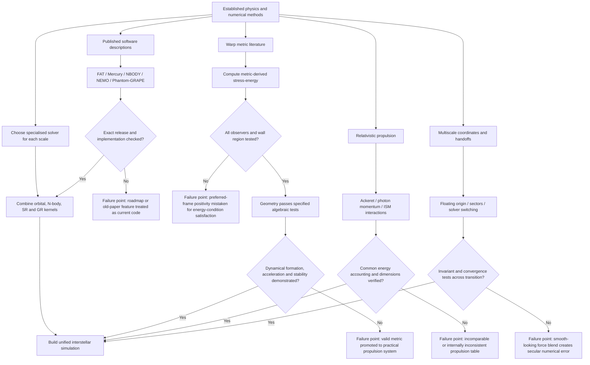

# Adversarial Review of *Computational Physics Kernels, Numerical Integrators, and Relativistic Mathematical Formulations for Hard-Science Interstellar Simulation*

## Executive assessment

The uploaded document is an unusually ambitious synthesis spanning astrodynamics, collisional and collisionless \(N\)-body dynamics, SIMD optimisation, numerical relativity, speculative warp metrics, relativistic propulsion, interstellar-medium hazards, and game/simulation architecture. I treated the uploaded Markdown file as the claim set under review. fileciteturn0file0

The central finding is **mixed**. The document is strongest when summarising established numerical methods: NBODY6++GPU's hybrid parallelism, the broad structure of Chambers' hybrid symplectic method, Dehnen's momentum-conserving tree/FMM approach, ADM/BSSN concepts, Ackeret-style relativistic rocketry, and binary64 precision scaling are substantially sound. Several other sections, however, move from accurate concepts to **specific implementation claims, numerical constants, or physical conclusions that are unsupported, outdated, internally inconsistent, or demonstrably wrong**.

The most important corrections are:

1. **The Fortran-Astrodynamics-Toolkit section materially overstates what the current official toolkit implements.** Its own current overview marks Nyström and Adams integrators and atmospheric drag as unimplemented, while the uploaded document describes all three as working FAT capabilities. The official variable-step RK documentation also lists a different current solver set. citeturn10search3turn10search0
2. **The Mercury discussion conflates available package integrators with the close-encounter algorithm.** Chambers' hybrid scheme numerically integrates encounter groups and specifically advocates Bulirsch–Stoer; RADAU is also distributed with Mercury but is not simply interchangeable in the way the document implies. Chambers also did not prescribe a universal \(r_{\rm crit}=3R_H\); he recommends a criterion depending both on Hill radius and distance travelled per timestep. citeturn16view3turn12view7
3. **The Phantom-GRAPE section presents estimated or architecture-dependent AVX-512 details as established implementation facts.** A 2019 primary paper documents AVX2 in detail but discusses AVX-512 performance as an estimate for a future implementation. citeturn18search0
4. **The warpax percentages in the uploaded document should not be used.** The current 2026 manuscript reports wall-restricted values radically unlike those quoted in the file: at its matched benchmark, Alcubierre is about \(0.9\%\) Type I and \(99.1\%\) Type IV, Natário about \(10.1/89.9\%\), Van den Broeck about \(12.2/87.8\%\), and Rodal \(100/0\%\). The uploaded text instead gives Alcubierre \(98.0\%\) Type I, Natário \(97.5\%\), and similar values. Different denominator/domain choices may explain part of the discrepancy, but without those qualifications the numbers are misleading. citeturn14view3turn12view2
5. **The Fuchs et al. positive-energy result is real but much narrower than the document's rhetoric sometimes suggests:** it is a *constant-velocity, subluminal* solution with a positive-ADM-mass matter shell. It is not evidence for practical, reactionless, or faster-than-light propulsion. citeturn15view0
6. **The claimed Bondi steering law exists, but its status is overstated.** The current source derives \(-\dot m\ge3m|\alpha|\) for its radiating-shell construction and presents a broader no-reactionless-steering argument, but it also explicitly limits itself to subluminal motion, radiation-reaction propulsion, finite manoeuvres, felt proper acceleration, and leaves one distributional positive-Bondi-mass analytic step open. The source located here is an arXiv manuscript, so “fundamental theorem” should be replaced by a qualified description of a recent proposed result. citeturn15view4turn16view0
7. **The dust example contains a three-orders-of-magnitude mass–size inconsistency.** A \(10^{-9}\,\mathrm{kg}\) grain is indeed \(1\,\mu\mathrm g\), but at ordinary solid densities its radius is roughly \(40\!-\!60\,\mu\mathrm m\), not \(5\,\mu\mathrm m\). A \(5\,\mu\mathrm m\)-radius grain has mass of order \(10^{-12}\,\mathrm{kg}\). The quoted \(1.39\times10^7\) J impact energy at \(0.5c\) is correct **for \(10^{-9}\,\mathrm{kg}\)**, but not for the stated grain size.
8. **The light-sail energy table is numerically inconsistent both with the document's own displayed equation and with an exact relativistic perfect-mirror calculation.** For an ideal reflector, the incident light energy is
   \[
   \frac{E_{\rm light}}{m}
   =\frac{c^2}{2}
   \left[
   \sqrt{\frac{1+\beta}{1-\beta}}-1
   \right],
   \]
   giving about \(4.74\times10^{15}\,\mathrm{J\,kg^{-1}}\) at \(0.1c\) and \(3.29\times10^{16}\,\mathrm{J\,kg^{-1}}\) at \(0.5c\). citeturn11view6
9. **The “White torus” row contains an elementary dimensional contradiction:** \(700\,\mathrm{kg}\,c^2\approx6.29\times10^{19}\) J, whereas the same cell states \(3\times10^{44}\) J. Those differ by about \(4.8\times10^{24}\), so they cannot describe the same energy.
10. **The weak-field proper-time handoff has the wrong sign under the standard Newtonian-potential convention.** With \(\Phi<0\),
   \[
   \frac{d\tau}{dt}\simeq
   \sqrt{1+\frac{2\Phi}{c^2}-\frac{v^2}{c^2}},
   \]
   not \(\sqrt{1-v^2/c^2-2\Phi/c^2}\). The document could rescue its expression only by explicitly defining a *positive* potential \(U=GM/r=-\Phi\).

My confidence scale is: **High** \(\gtrsim90\%\), **Moderate** roughly \(70\!-\!90\%\), and **Low** below roughly \(70\%\). These are confidence levels in this review's conclusions, not frequentist probabilities.

| Major claim family | Adversarial verdict | Principal problem or support | Confidence |
|---|---|---|---|
| FAT numerical capabilities | **Materially inaccurate/outdated** | Current official overview explicitly leaves Nyström, Adams and drag unchecked; variable-step RK list also differs. citeturn10search3turn10search0 | High |
| NBODY6++GPU architecture | **Strongly supported** | Million-body capability and MPI+GPU+OpenMP+AVX/SSE architecture match the primary paper. citeturn17search2 | High |
| Mercury hybrid integrator | **Core correct; implementation details overstated** | Correct Hamiltonian-switching idea; \(r_{\rm crit}\) and RADAU/BS wording are too categorical. citeturn16view3turn12view7 | High |
| gyrfalcON momentum conservation | **Strongly supported with wording caveat** | Symmetric mutual interactions conserve linear momentum; \(O(N)\) is a complexity description, not an unconditional measured law. citeturn17academia47turn17search13 | High |
| Phantom-GRAPE SIMD details | **Partly supported** | AVX2 implementation is well documented; cited-era AVX-512 details were predictions/estimates. citeturn18search0 | High |
| Einstein Toolkit/BSSN discussion | **Broadly sound but historically frozen** | McLachlan/Kranc/CCZ4 claims have basis, but the modern toolkit now includes newer CarpetX/GPU evolution infrastructure. citeturn13search9turn13search1 | High |
| WarpFactory methodology | **Broadly supported** | Numerical metric-to-\(T_{\mu\nu}\) analysis is a genuine published methodology. citeturn2search4 | High |
| Uploaded warpax percentages | **Unreliable/outdated** | Current manuscript's wall-restricted Type-I/IV statistics are radically different. citeturn14view3 | High |
| Positive-energy constant-velocity Fuchs shell | **Supported in its narrow domain** | Peer-reviewed subluminal, constant-velocity construction satisfying energy conditions. citeturn15view0 | High |
| “No-reactionless-steering theorem” | **Promising but overstated** | Recent radiative-shell result has explicit assumptions and unresolved scope issues. citeturn15view4turn16view0 | High |
| Relativistic rocket kinematics | **Largely correct** | Ackeret/rapidity and constant-proper-acceleration formulae are standard; later force-frame handling is less clean. | High |
| ISM impact hazard | **Qualitatively right, quantitatively oversimplified** | Primary work finds material-specific implantation, tracks, cratering and erosion rather than a single heat-flux model. citeturn19academia46 | High |
| Dust grain example | **Size label wrong** | \(10^{-9}\) kg corresponds to tens of micrometres radius, not \(5\,\mu\mathrm m\), for normal solids. | High |
| Bussard/Fishback limit | **Qualitative conclusion strong; exact formula weakly supported** | Modern re-analysis obtains much lower cut-off speeds than historical estimates. citeturn19search7 | High |
| Magsail as relativistic brake | **Qualitatively supported** | Original NASA study explicitly identifies high-speed ISM drag as useful braking. citeturn19search1 | High |
| Propulsion comparison table | **Not methodologically comparable as written** | Energy definitions differ by row; laser values are wrong; one warp row contains a \(10^{24}\)-scale internal contradiction. | High |
| Floating-origin / fixed-point architecture | **Reasonable engineering proposal, not a physical necessity** | ULP arithmetic is mostly correct; specific tier sizes and solver thresholds are design choices. | High |
| Weak-field clock equation | **Likely sign error** | Wrong for the conventional \(\Phi=-GM/r\) definition unless the sign convention is explicitly reversed. | High |

Across the requested evaluation dimensions, the largest weakness is not the mathematics per se but **provenance discipline**. Factual accuracy ranges from excellent to seriously wrong depending on subsection; logical coherence is generally good until the text turns an individual model into a universal conclusion; methodological rigour is strong for classical integrator descriptions but weak in the synthesis tables; evidence quality is uneven because peer-reviewed work sits alongside ResearchGate mirrors, Wikipedia, blogs and Reddit; statistical validity is often inapplicable but becomes important for ISM assumptions, performance benchmarks and grid percentages; reproducibility is impaired by missing parameter sets and source-to-claim mapping; author/developer overlap is relevant in several software/warp-drive claims; and alternative explanations are insufficiently discussed, especially for energy-condition diagnostics, material damage and performance measurements.

## Numerical code and HPC claims

The document's treatment of **NBODY6++GPU and gyrfalcON is substantially better than its treatment of FAT and Phantom-GRAPE**.

The strongest direct contradiction concerns FAT. The uploaded text describes FAT as already providing Runge–Kutta–Nyström integration, Adams–Bashforth–Moulton/DDEABM propagation, and atmospheric drag. Yet the project's own current overview marks “Nystrom”, “Adams”, and “atmospheric drag” as not implemented, while listing Runge–Kutta, geopotential, solar-radiation-pressure, JPLEPH and SPICE functionality as implemented. citeturn10search3 The variable-step module presently documents Fehlberg 7(8), Fehlberg 8(9), Verner 8(9), and several Feagin methods; it contains event handling and configurable absolute/relative tolerances, but this does not support the document's assertion that DDEABM itself is one of FAT's active propagation engines—the module merely notes that one initial-step estimator originated in DDEABM. citeturn10search0turn10search4

That is not a small wording issue: a software architecture based on calling a solver that the dependency does not implement will fail at implementation time. **Recommended wording:** “FAT currently provides a broad family of high-order Runge–Kutta methods and event detection; Nyström, Adams and some force models appear on the project's roadmap and should not be treated as available without checking the exact repository revision.” citeturn10search3

A second FAT caveat concerns modified equinoctial elements. Their usefulness near \(e=0\) and the usual prograde equatorial limit is sound, but the common prograde formulation does **not** remove the retrograde \(i=\pi\) singularity. Therefore the statement that the transformation solves singularities as \(i\to0,\pi\) is overbroad. The project's own modified-equinoctial documentation identifies the retrograde-equatorial exception. citeturn0search8

By contrast, the NBODY6++GPU description gets the central architecture right. Wang et al. describe a direct collisional \(N\)-body code combining MPI, GPUs, OpenMP and AVX/SSE, explicitly targeting million-particle simulations. They report that GPU acceleration is particularly effective for the long-range regular force and that AVX/SSE plus OpenMP accelerates prediction and neighbour/irregular calculations; their million-particle benchmark used 320 CPU cores and 32 K20X GPUs. citeturn17search2 Thus the document's high-level account of Ahmad–Cohen splitting, heterogeneous regular/irregular force evaluation, block timesteps and million-body scaling is credible. Exact performance ratios, however, should always be attached to hardware, compiler, \(N\), binary fraction and workload; they are not intrinsic properties of the algorithm. citeturn17search2

The same distinction applies to **gyrfalcON**. Dehnen's original method really does use symmetric mutual cell–cell interactions so Newton's third law is satisfied by construction and total linear momentum is conserved to numerical precision in the force calculation. The 2000 paper described measured scaling as “almost linear”; the subsequent 2002 paper explicitly developed the method as a hierarchical \(O(N)\) algorithm and reported empirically sublinear cost over its tested range. citeturn17academia47turn17search13 The file's “strict \(O(N)\)” phrasing should therefore be softened to “an \(O(N)\)-class hierarchical method whose measured scaling can be close to or even sublinear over particular benchmark ranges”. Also, exact action–reaction symmetry in the force approximation does not by itself imply exact conservation of every invariant after finite-timestep integration.

The Mercury section captures Chambers' core idea accurately: transfer the rapidly varying close-encounter potential from the perturbative kick into the part integrated numerically, while retaining an efficient symplectic mapping away from encounters. Chambers explicitly describes bodies outside encounters as moving on analytically solved Kepler orbits, while encounter bodies have the Kepler and \(1-K\) close-encounter terms integrated numerically. citeturn16view3

Two details need correction. First, Chambers states that \(r_{\rm crit}\) should generally be the larger of a Hill-radius term and a timestep-times-velocity term, with problem-dependent coefficients; he gives \(3\!-\!10\) Hill radii as a useful coefficient range rather than defining \(3R_H\) as a universal switching distance. citeturn16view3 Second, he says the close-encounter numerical algorithm is in principle a matter of choice but advocates Bulirsch–Stoer for robustness; he remarks that Everhart's RADAU can be faster but occasionally has difficulty in very close encounters. Mercury distributes RADAU as an additional package integrator. citeturn12view7turn12view6 **Corrective wording:** “Mercury's hybrid map conventionally uses an adaptive high-accuracy numerical method—Chambers recommends Bulirsch–Stoer—for encounter groups; the package also contains an independent Everhart RADAU implementation.”

The Phantom-GRAPE section illustrates another recurring problem: **accurate microarchitectural language is used to hide uncertain provenance**. The 2019 PASJ implementation really does describe explicit YMM register use, four target particles against two source cells for its quadrupole kernel, `VRSQRTPS`, horizontal reductions and AVX2-level instruction scheduling. But the same paper's AVX-512 discussion is explicitly an *estimate*: it calculates expected speedups by assuming twice-wide registers and additional registers, and says further performance is expected when AVX-512 is implemented. citeturn18search0 Hence statements such as “the AVX-512 kernel executes \(4i\times4j\) or \(2i\times8j\) interactions per clock cycle” require a particular current code revision and hardware benchmark; they cannot be justified from the cited AVX2 literature. “Sixteen single-precision lanes per vector instruction” is also not equivalent to “16 interactions per clock cycle”, because instruction dependencies, reciprocal-square-root throughput, loads and reductions determine realised throughput. citeturn18search0

The Einstein Toolkit portion is historically recognisable but should not be presented as a frozen architecture. ADMBase does provide the standard 3-metric, extrinsic curvature, lapse and shift interface, and McLachlan is a Kranc-generated Einstein solver associated with BSSN; CCZ4 was added to McLachlan in the 2012 toolkit release. citeturn13search4turn16view4turn13search9 However, by the 2026 Hypatia release the Toolkit also contained newer GPU-oriented CarpetX evolution thorns, including Cottonmouth BSSNOK/Z4c and CanudaX. citeturn13search1 Thus “the Einstein Toolkit is built atop Carpet” is now too restrictive. Likewise, the document's very specific assertion that Kranc-generated arithmetic is arranged to fit within a 32 kB L1 instruction cache is not established by the cited Toolkit documentation and should be removed unless a compiler/performance source is supplied.

**Methodological verdict on this section:** the mathematics of the established integrators is mostly credible, but **implementation status must be checked against tagged source releases rather than inferred from module names, old papers or project roadmaps**. The correct reproducibility unit is not “FAT”, “Mercury”, or “Phantom-GRAPE” generically; it is an exact release/commit, compiler, build flags, hardware platform and benchmark.

## Relativity and warp-drive claims

The document is right to distinguish ordinary numerical relativity from “inverse” warp-metric analysis. WarpFactory is a published numerical framework for specifying a metric, computing the resulting stress-energy and testing energy conditions rather than time-evolving self-consistent matter from Cauchy data. citeturn2search4 That workflow is legitimate mathematics: if a sufficiently differentiable metric is supplied, Einstein's equations determine the stress-energy tensor that would be required for that geometry. It does **not**, by itself, show that a known material, equation of state, dynamical formation process or stable control system can realise that tensor.

That distinction matters because the document repeatedly shifts from **“a metric satisfying an algebraic energy-condition test exists”** to language resembling **“a physical propulsion architecture exists”**. Those are not equivalent propositions.

The classical Alcubierre assessment is not problematic: its standard wall requires exotic stress-energy, and subsequent work has investigated the severity and quantum-inequality constraints. More importantly for this review, Santiago, Schuster and Visser showed why checking the Eulerian observer alone is insufficient: WEC requires positivity for *all* timelike observers, not merely the comoving one. Within the class analysed in their paper, physically reasonable warp drives violate WEC, SEC and DEC, and under additional plausible assumptions NEC as well. citeturn15view3

This makes the uploaded warpax passage particularly problematic. It gives highly precise Hawking–Ellis Type-I fractions—“100% Rodal, 99.9% Lentz, 99.6% WarpShell, 98.4% Van Den Broeck, 98.0% Alcubierre, 97.5% Natário”—without defining whether the denominator is the entire mostly-flat grid, the active wall, proper-volume weighting, a particular velocity, or a particular resolution. Current warpax material reports a very different wall-restricted picture: at one matched benchmark Alcubierre is \(0.9\%\) Type I/\(99.1\%\) Type IV, Natário \(10.1/89.9\%\), Van den Broeck \(12.2/87.8\%\), and Rodal \(100/0\%\). citeturn14view3 The same current manuscript warns that several benchmark walls are poorly resolved and explicitly excludes Lentz from its quantitative comparison because its wall is vastly thinner than a grid cell in that setup. citeturn12view2

This is a classic **statistical-denominator failure**: both “98% Type I over the full computational volume” and “99% Type IV in the wall” can theoretically coexist if most of the grid is flat vacuum. Without stating the sampling domain, resolution, weighting and velocity, percentages are scientifically uninterpretable. **Corrective wording:** “Hawking–Ellis fractions depend strongly on whether one samples the whole domain or restricts to the active wall; current wall-restricted warpax benchmarks find Type-IV-dominated Alcubierre, Natário and Van-den-Broeck walls, while Rodal remains Type I.” citeturn14view3

The current warpax analysis is itself informative for another reason: it reinforces the need to distinguish “positive energy density in one frame” from satisfaction of an energy condition. It reports that the Rodal geometry is globally Type I but that an Eulerian calculation misses roughly 72% of wall WEC violations and 73% of wall DEC violations that become apparent for boosted observers. citeturn12view2turn16view1 So the document is correct in principle that all-observer testing matters, but its quoted numerical summary is stale or defined incompatibly with the current analysis.

The **Fuchs–Helmerich constant-velocity result survives adversarial review much better**. Their 2024 peer-reviewed CQG paper explicitly presents a subluminal constant-velocity warp solution built by combining a positive-ADM-mass matter shell with a shift distribution and reports satisfaction of all energy conditions. citeturn15view0 Current warpax work also includes a Fuchs construction as a positive Type-I comparison case with a positive NEC margin at its tested resolution. citeturn16view2

The caveat is scope. The Fuchs result demonstrates an allowed **geometry plus required matter tensor**, at constant velocity. It does not establish that such matter can be assembled, accelerated, controlled or made stable at engineering scales. It also does not invalidate Santiago et al.'s result straightforwardly because Fuchs departs from the simpler unit-lapse/flat-spatial-slice warp template to which many no-go statements apply. citeturn15view3turn15view0 The two literatures should therefore be presented as exploring different metric/matter classes, not as one side having simply disproved the other.

The uploaded discussion of **radiative steering** needs an even stronger caveat. The 2026 source derives, for its axisymmetric photon-rocket exterior,
\[
-\dot m\ge3m|\alpha|,
\]
from non-negative angular radiation intensity. citeturn15view4turn15view5 But the manuscript's own limitations are substantial: the construction is subluminal; it is explicitly “not reactionless”; occupants feel proper acceleration; the minimum-fuel mass fraction obeys \(m_f/m_0=e^{-3\Delta\eta}\) for a rectilinear boost; global eternal existence is not claimed; and a full distributional positive-Bondi-mass result across the shell retains an open analytic step. citeturn16view0

Accordingly, the uploaded sentence asserting a **“fundamental no-reactionless-steering theorem”** is too strong without attribution and assumptions. A defensible replacement is:

> “A recent radiative-shell analysis derives a no-reactionless-steering result, under its asymptotic and energy-condition assumptions, and obtains the photon-rocket control bound \(-\dot m\ge3m|\alpha|\). The resulting construction is subluminal, expends Bondi mass as radiation, and still has open global/matching questions.”

The conflicts-of-interest dimension here needs careful wording. WarpFactory and the Fuchs physical-warp papers share authors/developers, so software validation and scientific claims are not fully independent. That is **not evidence of misconduct**; author-developed scientific software is normal. It does mean that independent implementations using symbolic tensor algebra, alternative numerical differentiation and rigorous interval/error bounds carry disproportionate evidentiary value. The newer warpax work provides some useful independent cross-checking precisely because it approaches the all-observer question differently. citeturn15view0turn16view2

## Interstellar environment and propulsion claims

The relativistic kinematics are among the strongest parts of the document. The rapidity relations, hyperbolic-motion equations under constant proper acceleration, and Ackeret-style mass-ratio expression are internally coherent. Recomputing its mass ratios from
\[
R=\exp\!\left[\frac{c}{v_e}\operatorname{artanh}\beta\right]
\]
reproduces most of the propulsion-table mass-ratio entries to rounding. For example, \(I_{sp}=10^4\) s implies \(v_e/c\simeq3.271\times10^{-4}\), which gives \(R\simeq1.62\times10^{133}\) at \(0.1c\), so the spectacular Orion number is a consequence of the equation rather than a typo.

That does **not** make the propulsion table methodologically valid as a whole. The “energy per kg payload” column mixes incompatible definitions: approximate exhaust kinetic energy in some nuclear rows, annihilated rest-mass energy in the antimatter row, incident optical beam energy in the sail row, and total field/shell energies in the warp rows. Consequently, column-to-column comparisons do not represent a common efficiency metric. A rigorous table should separately give at least: vehicle kinetic energy, propellant rest mass, exhaust kinetic energy, primary-source input energy, conversion efficiency, rejected waste heat and external infrastructure energy.

The **interstellar-medium treatment** has the correct qualitative message but too much false precision. Crawford's review emphasises that the local ISM is heterogeneous and incompletely known and recommends using pessimistically high densities for damage while using low plausible densities when evaluating devices that depend on the ISM for braking. citeturn19academia47 A universal \(n_0=0.1\!-\!1~\mathrm{cm^{-3}}\) “Local Bubble/Galactic Disk” value is therefore an engineering scenario, not an environmental constant.

The proton flux and individual kinetic-energy calculations are straightforward special relativity, but translating them into “shield ablation” by dividing incident kinetic-energy flux by a single sublimation enthalpy discards much of the actual interaction physics. Hoang et al. model ion tracks, heavy-element damage, dust melting, explosive evaporation and material dependence; at \(0.2c\) they find gas-related surface damage of order \(0.1\) mm for quartz over one assumed column, while dust can erode roughly \(0.5\) mm under another assumed column. citeturn19academia46 These mechanisms do not reduce to all intercepted kinetic energy instantly thermalising at the front surface. Thus the document's ablation equation is best described as a **conservative calorimetric toy model**, not a shielding law.

The dust example contains a particularly clear arithmetic/material inconsistency. For a spherical grain,
\[
r=\left(\frac{3m}{4\pi\rho}\right)^{1/3}.
\]
For \(m=10^{-9}\) kg and \(\rho=2{,}000~\mathrm{kg\,m^{-3}}\), \(r\approx49~\mu\mathrm m\). Conversely, a \(5~\mu\mathrm m\)-radius grain at that density has mass about \(1.05\times10^{-12}\) kg. Hence the document combines the **energy of a \(\sim50\,\mu\mathrm m\)-radius grain with the label of a \(\sim5\,\mu\mathrm m\) grain**. The impact energy
\[
(\gamma-1)mc^2\simeq1.39\times10^7~\mathrm J
\]
at \(0.5c\) is correct for \(m=10^{-9}\) kg, corresponding to roughly \(3.3\) kg TNT equivalent, but the implied abundance of such grains is completely different from the abundance of true \(5\,\mu\mathrm m\) grains. Given the steep grain-size distribution, this is not a cosmetic error. ISM-dust bombardment is nevertheless a genuine hazard supported by dedicated calculations. citeturn19academia46

The bremsstrahlung section is less secure. A compact yield law of the form
\[
\eta_{\rm brem}\propto Z E
\]
can be useful in restricted thick-target regimes, but the document treats it as a universal relativistic shield law without specifying its validity interval, electron spectrum, target thickness, self-absorption or secondary cascade treatment. Its conclusion that spacecraft shields must therefore be “strictly” low-\(Z\) is too absolute. Low-\(Z\) material can reduce electron bremsstrahlung production, but actual radiation-shield optimisation also involves areal density, proton stopping, nuclear fragmentation, neutron production, thermal performance and structural requirements. The document needs a transport calculation—e.g. Monte Carlo particle transport—not a one-factor \(Z\) rule.

The **Bussard ramjet conclusion is stronger than some of the equations used to reach it**. The weakness of direct proton–proton fusion is a serious objection, and intake drag/field engineering is unquestionably difficult. But the file treats one historical Fishback-style limit as an “absolute” mathematical ceiling. A modern re-analysis of Fishback's magnetic scoop found the basic field configuration physically feasible in its model yet concluded that required solenoids become absurdly long and that the cut-off speeds are orders of magnitude lower than previously thought. citeturn19search7 That is important adversarial evidence: the qualitative verdict “conventional magnetic Bussard ramjets are extraordinarily difficult” becomes stronger, while the uploaded *specific* \(\gamma_{\max}\) equation becomes less trustworthy as a universal bound.

The statement that passive magnetic sails are useful **relativistic brakes** is much better supported. Andrews and Zubrin explicitly describe interaction with the solar wind or ISM as generating drag and lift and identify relativistic ISM drag as useful for interstellar deceleration. citeturn19search1 However, “exclusively a brake” should be understood as an energy statement in a nearly stationary ambient ISM: the sail can exchange momentum directionally and generate lift/steering components, even though it cannot extract sustained forward kinetic energy from a medium at rest. Inside a moving stellar wind the situation depends on relative velocity and sail orientation. citeturn19search1

The largest quantitative failure in the propulsion section is the **laser-sail energy calculation**. For an ideal mirror initially at rest, conservation of energy and momentum gives
\[
\frac{E_{\rm light}}{m}
=
\frac{c^2}{2}
\left[
\sqrt{\frac{1+\beta}{1-\beta}}-1
\right].
\]
Kipping derives this directly for an ensemble of photons. citeturn11view6 It gives:

| Target speed | Exact ideal-reflector incident energy | Uploaded table | Ratio, uploaded/exact |
|---|---:|---:|---:|
| \(0.1c\) | \(4.74\times10^{15}\) J/kg | \(9.95\times10^{15}\) J/kg | \(2.10\) |
| \(0.5c\) | \(3.29\times10^{16}\) J/kg | \(3.11\times10^{17}\) J/kg | \(9.45\) |

Worse, inserting \(\mathcal R=0.9999\) into the **equation printed in the uploaded document itself** gives approximately \(5.04\times10^{15}\) and \(5.88\times10^{16}\) J/kg, respectively—not the table's values. The table therefore fails an internal reproduction test even before comparison with outside literature. An imperfect sail additionally requires a treatment of absorption, re-emission and changing rest mass/temperature rather than merely dividing an ideal result by reflectivity. citeturn11view6

There is a similarly unequivocal error in the classic-warp row. The phrase “\(3.0\times10^{44}\) J … \(\sim700\) kg \(c^2\)” is impossible because
\[
700c^2 \approx 6.29\times10^{19}\ {\rm J},
\]
so the two stated quantities differ by approximately \(4.77\times10^{24}\). This entry should be deleted and rebuilt from the actual source, including bubble size, wall thickness, velocity, energy definition and sign convention.

**Recommended corrective wording for the entire propulsion table:** “These rows use different resource metrics and are not directly comparable. Report mass ratio, vehicle kinetic energy, onboard propellant energy, external supplied energy and waste heat separately; do not collapse all of them into one ‘total energy per kg payload’ column.”

## Simulation architecture and mathematical handoffs

The binary64 ULP analysis is mostly correct. At \(1\) AU, a binary64 coordinate has an ULP of roughly \(3.05\times10^{-5}\) m; around \(0.8\) ly it is about \(1\) m; near Alpha Centauri-scale coordinates it is several metres; and at \(10^4\) ly it is kilometres. Those are direct consequences of
\[
\mathrm{ULP}(x)=2^{\lfloor\log_2|x|\rfloor-52}.
\]
So the document is right that a single galactic-origin binary64 coordinate is inappropriate for centimetre- or millimetre-scale local simulation.

The conclusion “therefore use global integer sectors plus local floating origins” is a sound engineering proposal, but **not the unique solution**. Hierarchical reference frames, double-double arithmetic, compensated relative coordinates, integer cell indices plus local doubles, or arbitrary/fixed precision can all work. A 64.64 signed fixed-point coordinate would offer \(2^{-64}\) m fractional granularity but only roughly \(\pm2^{63}\) m—about \(\pm975\) light-years—before an additional higher-level sector is needed. The file's sector hierarchy can provide that extra range, but this should be described as a representation design rather than “the” required architecture.

There is also a portability issue: “`integer(int128)` in Fortran” is not a Fortran 2018 guarantee. The standard provides selected integer kinds according to compiler capabilities; a native 128-bit integer is implementation-dependent. A production design should therefore abstract the global-coordinate representation behind a portable interface rather than requiring a particular non-universal kind.

The proposed **physics state machine** contains sensible separation-of-scales ideas but its activation thresholds are arbitrary. Nothing singular happens physically at \(\beta=0.01\); \(\gamma-1\approx5\times10^{-5}\) merely indicates that Newtonian kinematic errors have become potentially relevant for a chosen tolerance. Solver switching should be controlled by an error budget, not a hard-coded “relativistic” speed. For example, if a simulation tolerates \(10^{-6}\) relative kinematic error, special-relativistic corrections need to enter much earlier than if it tolerates \(10^{-3}\).

Likewise, blending two force laws smoothly does **not** automatically preserve symplecticity. Chambers' switch is derived at the Hamiltonian level: the potential is partitioned between Hamiltonian pieces and the corresponding operators are composed symmetrically. citeturn16view3 Merely taking
\[
\mathbf a=(1-s)\mathbf a_1+s\mathbf a_2
\]
between two independent solvers may create a force that does not derive from the intended Hamiltonian, and can introduce secular work or momentum errors. Therefore calling a generic handoff “Chambers-style Hamiltonian / Force Blend” is unsafe unless the blended system is actually derived from a common Hamiltonian or validated against invariants.

The relativistic force handoff also has a frame-definition problem. The document writes a coordinate-acceleration transformation and labels the inputs “proper thrust” and “ISM drag”, but the standard relation
\[
\mathbf a
=
\frac{1}{\gamma m}
\left[
\mathbf F-
\frac{(\mathbf F\cdot\mathbf v)\mathbf v}{c^2}
\right]
\]
uses the **three-force measured in the coordinate frame**. A proper force/four-force requires a Lorentz transformation before it can simply be inserted as \(\mathbf F\). For collinear forces the familiar \(\alpha/\gamma^3\) result is recovered, but matching that special case is not sufficient to prove the vector expression is valid for transverse thrust. The engine therefore needs explicit types such as `FourForce`, `ComovingThreeForce` and `CoordinateThreeForce` rather than treating “force” as frame-free.

The proper-clock equation is more serious. Under the standard weak-field metric convention
\[
g_{00}\simeq-\left(1+\frac{2\Phi}{c^2}\right),\qquad
\Phi=-\frac{GM}{r},
\]
the leading relation is
\[
\boxed{
\frac{d\tau}{dt}
\simeq
\sqrt{
1+\frac{2\Phi}{c^2}
-\frac{v^2}{c^2}
}
}.
\]
Because \(\Phi<0\), both gravity and velocity slow the local clock relative to asymptotic coordinate time. The uploaded
\[
\sqrt{1-v^2/c^2-2\Phi/c^2}
\]
would make a stationary clock deeper in a conventional negative gravitational potential run *faster*. This should be corrected or the potential should be explicitly redefined as a positive \(U=GM/r\).

Finally, the architectural prescription to use KS regularisation automatically whenever any two objects come close is too broad. KS regularisation is excellent for gravitational point-mass two-body singularities, but a spacecraft approaching a planet, asteroid or another spacecraft is generally encountering a physical surface/collision problem before \(r\to0\). Regularising the mathematical \(1/r\) singularity should not permit an extended body to pass numerically through another body. Collision geometry, finite radii, tidal disruption and contact physics need higher priority than regularisation for such entities.

**Corrected architectural principle:** use a hierarchy selected by quantified approximation error: Newtonian \(N\)-body where \(GM/(rc^2)\), \(v^2/c^2\) and required accuracy permit it; PN corrections where a controlled expansion remains valid; full GR only where curvature/dynamics requires it; and represent transitions through a mathematically common model or overlap region validated for conserved quantities.

## Reproducibility, uncertainty and decisive tests

The document is not presently reproducible as a scientific specification. It has a long bibliography, but individual numerical statements are not tied to exact equations, source versions or test cases. Several citations are secondary repositories, ResearchGate pages, blogs, Wikipedia or Reddit rather than the underlying paper or software documentation. The malformed `[span_…]` artefacts throughout equations are an additional red flag: they can silently corrupt indices and Hamiltonians and should be eliminated before any expression is translated into code.

The following table maps the most important uncertainties to decisive tests.

| Issue | Required test or data | Passing criterion |
|---|---|---|
| FAT capabilities | Pin exact FAT commit/release; compile examples for every claimed RKN, Adams and drag feature | Every claimed solver/model exists as callable tested code; otherwise remove claim. Official current overview presently says otherwise. citeturn10search3 |
| Mercury handoff | Reproduce Chambers' comet and embryo close-encounter tests | Error behaviour comparable with published BS/hybrid results; no spurious secular drift. citeturn12view6 |
| NBODY Hermite/AC implementation | Energy-error convergence against timestep parameter \(\eta\), with/without AC and regularisation | Expected convergence plus stable binary treatment; benchmark hardware disclosed. |
| gyrfalcON conservation | Isolated system, zero external forces; track \(\sum m_i\mathbf v_i\) and angular momentum | Linear momentum remains at round-off scale for symmetric force kernel; integration errors reported separately. citeturn17academia47 |
| Phantom-GRAPE AVX-512 claim | Publish exact kernel source, CPU model, compiler, instruction counters and interactions/s | Distinguish lane width, vector instructions/cycle and complete force interactions/s. |
| WarpFactory curvature | Evaluate analytic metrics with known Einstein tensor at \(\Delta x,\Delta x/2,\Delta x/4\) | Demonstrate expected stencil convergence before testing novel metrics. |
| warpax classification | Symbolic/high-precision cross-check of eigenvalues plus wall-restricted proper-volume sampling | Report whole-grid and wall fractions separately; demonstrate grid convergence. Current work itself shows why this matters. citeturn14view3turn12view2 |
| Fuchs shell | Independent implementation using symbolic/AD and independent tetrad/eigenvalue calculation | All-observer NEC/WEC/SEC/DEC remain non-negative under resolution and parameter perturbations. citeturn15view0turn16view2 |
| Radiative steering | Independent derivation of Bondi flux and junction conditions; numerical dynamical evolution | Recover \(-\dot m\ge3m|\alpha|\) within stated assumptions and establish stability/global matching separately. citeturn15view4turn16view0 |
| ISM shielding | Particle-transport simulation plus measured material stopping/erosion data over realistic composition spectrum | Reproduce material-specific implantation, sputtering, secondary radiation and dust cratering; not merely calorimetric heating. citeturn19academia46 |
| Dust model | Specify \(dN/da\), composition and grain-density distribution | Mass-radius relation exactly consistent for every sampled grain. |
| Bussard scoop | MHD/PIC field solution with coil geometry, stress and radiation losses | Net longitudinal momentum gain positive after collection losses; compare with modern Fishback re-analysis. citeturn19search7 |
| Magsail braking | Relativistic plasma/particle simulation at several densities and orientations | Force/work direction follows ambient-flow energy exchange; quantify drag and lift separately. citeturn19search1 |
| Laser sail | Photon-by-photon four-momentum conservation and independent ODE integration | Recover the exact perfect-mirror energy relation in the \(\mathcal R\to1\) limit. citeturn11view6 |
| Clock integration | Schwarzschild circular/static test cases and SR-only Minkowski limit | Static clocks deeper in a conventional negative potential accumulate *less* proper time; \(\Phi\to0\) gives \(d\tau/dt=1/\gamma\). |
| Solver transitions | Integrate identical trajectory wholly with high-fidelity reference and with state-machine switching | State, energy, momentum and proper time agree within a declared global error budget. |

For numerical claims, “statistical validity” should also be interpreted appropriately. Solver convergence is not primarily a statistical question; it requires deterministic error analysis and convergence testing. Performance claims, however, need repeated timings, hardware counters, uncertainty estimates and workload distributions. Environmental claims need probability distributions for density and dust rather than a single nominal number. Grid percentages need a defined sampling measure. Warp-shell “percentage of points” is especially vulnerable to meaningless statistics because expanding the empty vacuum region can arbitrarily drive a whole-grid percentage towards \(100\%\) without changing the wall physics. The current warpax emphasis on wall-restricted and proper-volume-weighted metrics is therefore methodologically preferable. citeturn14view3

For conflicts of interest and evidence independence, code authors are often the natural primary sources for implementation details, but **author benchmarks should not be the sole evidence for universal performance claims**. NBODY6++GPU's published benchmarks establish that its architecture can work at million-body scale on the reported cluster; they do not prove the same speedup on every contemporary platform. citeturn17search2 Similarly, Fuchs et al.'s published energy-condition result is meaningful, but independent tensor implementations and stability studies are needed before elevating the solution into an engineering assumption. citeturn15view0

A practical severity ranking for revision is therefore:

| Priority | Correction |
|---|---|
| **Critical** | Recompute the laser-sail equation/table; remove the \(700\,\mathrm{kg}c^2=3\times10^{44}\) J contradiction; correct the weak-field proper-time sign. |
| **Critical** | Replace the warpax percentages with parameter-, domain-, resolution- and version-specific values. |
| **High** | Correct FAT implementation-status claims. |
| **High** | Fix the \(10^{-9}\) kg/\(5\,\mu\mathrm m\) dust inconsistency. |
| **High** | Separate constant-velocity Fuchs shells from acceleration/steering claims. |
| **High** | Recast the Bondi steering result as a recent result under stated assumptions, not an unconditional established law. |
| **High** | Rebuild propulsion “energy/kg” columns using one consistent accounting scheme. |
| **Medium** | Correct Mercury \(r_{\rm crit}\) and RADAU/Bulirsch–Stoer wording. |
| **Medium** | Distinguish implemented AVX-512 kernels from estimates and hardware-specific optimisation claims. |
| **Medium** | Replace generic force blending with an error-controlled, invariant-tested handoff strategy. |

## Publication timeline, argument structure and primary sources

The chronology helps explain several errors: the uploaded document often combines conclusions from papers separated by decades as if they described a single modern software stack or settled physical theory.

| Date | Publication/development | Relevance to the uploaded claims |
|---|---|---|
| **1990** | Andrews & Zubrin, magnetic sails | Establishes solar-wind/ISM momentum exchange and explicitly identifies relativistic ISM drag as useful braking. citeturn19search1 |
| **1994** | Alcubierre warp metric | Establishes the classic moving-bubble construction and its exotic-matter problem. |
| **1999** | Chambers, hybrid symplectic integrator | Primary basis for Mercury's Hamiltonian switching, encounter treatment and \(r_{\rm crit}\) discussion. citeturn16view3turn12view7 |
| **2000** | Dehnen, momentum-conserving tree code | Introduces symmetric mutual cell–cell interactions and exact linear-momentum conservation in the approximate force calculation. citeturn17academia47 |
| **2002** | Dehnen, hierarchical \(O(N)\) force algorithm | Stronger basis for the gyrfalcON \(O(N)\)-class description. citeturn17search13 |
| **2012** | Einstein Toolkit adds McLachlan CCZ4 | Supports the document's historical CCZ4 claim. citeturn13search9 |
| **2015** | Wang et al., NBODY6++GPU | Demonstrates heterogeneous million-body direct \(N\)-body simulation. citeturn17search2 |
| **2017** | Hoang et al., relativistic spacecraft–ISM interactions | Shows that realistic damage includes tracks, erosion, melting and dust cratering rather than just bulk heating. citeturn19academia46 |
| **2017** | Kipping, relativistic light sails | Supplies an exact energy–momentum treatment that exposes the uploaded sail-energy error. citeturn11view6 |
| **2019** | Kodama & Ishiyama, AVX2 Phantom-GRAPE extension | Documents detailed AVX2 force kernels while treating AVX-512 performance as estimated. citeturn18search0 |
| **2021** | Bobrick & Martire physical-warp taxonomy | Broadens the discussion of positive-energy/sub-luminal warp geometries; does not by itself turn them into practical propulsion systems. citeturn5search6 |
| **2022** | Santiago, Schuster & Visser | Shows why preferred-observer positive density is insufficient and derives generic energy-condition problems in their warp-drive framework. citeturn15view3 |
| **2022** | Schattschneider & Jackson revisit Fishback | Finds severe magnetic-scoop engineering constraints and lower cutoff speeds. citeturn19search7 |
| **2024** | Helmerich et al., Warp Factory | Peer-reviewed metric/stress-energy numerical analysis framework. citeturn2search4 |
| **2024** | Fuchs et al., constant-velocity physical warp solution | Peer-reviewed subluminal, constant-velocity positive-ADM-mass construction satisfying energy conditions. citeturn15view0 |
| **2026** | warpax observer-robust analysis | Highlights all-observer tests, wall-restricted Type-I/IV structure and large discrepancies with preferred-frame diagnostics. citeturn16view1turn14view3 |
| **2026** | Radiative warp-shell steering manuscript | Derives the \(-\dot m\ge3m|\alpha|\) radiative control law while explicitly documenting major scope limitations. citeturn15view4turn16view0 |
| **2026** | Einstein Toolkit Hypatia | Illustrates why the document's Carpet/McLachlan-centric picture is no longer the full current Toolkit architecture. citeturn13search1 |

The document's argument can be represented as follows. The red-flag nodes are not necessarily false ideas; they are points where the conclusion no longer follows from the evidence without an additional assumption or test.

The most important **primary or first-party sources** for a corrected version are: Chambers' original Mercury hybrid-integrator paper for Hamiltonian splitting and encounter handling; Wang et al.'s NBODY6++GPU paper for the heterogeneous million-body implementation; Dehnen's 2000 and 2002 papers for symmetric momentum-conserving tree/FMM algorithms; the FAT project's own current documentation for actual solver status; the Einstein Toolkit's official documentation and release notes for current numerical-relativity infrastructure; Kodama and Ishiyama's PASJ SIMD implementation for Phantom-GRAPE-level AVX details; Hoang et al.'s *Astrophysical Journal* ISM-impact analysis; Kipping's relativistic photon-sail derivation; Santiago, Schuster and Visser's energy-condition critique; the peer-reviewed WarpFactory and Fuchs constant-velocity-shell papers; and the current warpax and radiative-steering manuscripts for claims specific to 2026. citeturn10search3turn17search2turn16view3turn17academia47turn17search13turn18search0turn13search1turn19academia46turn11view6turn15view3turn15view0turn14view3turn16view0

**Overall confidence: High.** The document contains enough correct underlying mathematics to serve as the basis of a serious hard-science simulation design, but it is **not reliable enough in its present form to serve as an implementation specification or quantitative reference**. Its most serious weaknesses are not exotic speculative assumptions themselves; they are unversioned software claims, missing denominator/resolution definitions, mixing of model domains, inconsistent resource accounting, and several easily reproducible numerical errors. The appropriate revision is therefore not to discard the document, but to separate it into three epistemic layers: **validated numerical algorithms**, **engineering models with explicit uncertainty**, and **speculative GR constructions whose mathematical existence is distinct from physical realisability**.