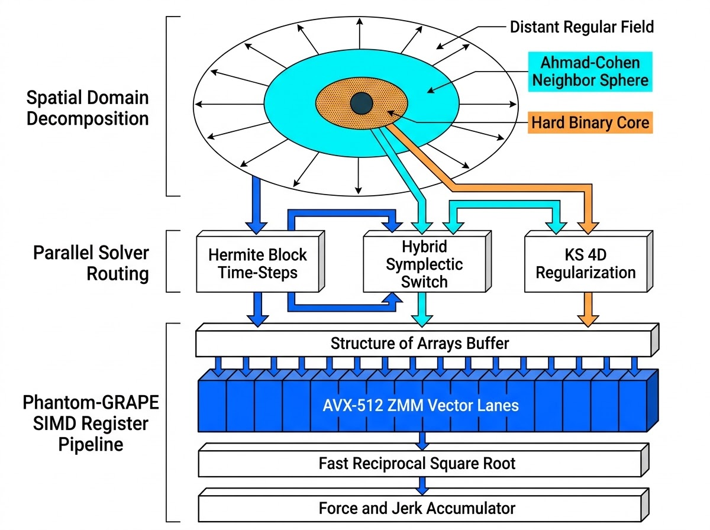

# Phantom-GRAPE layout and register kernel

- Unit: `astrophysics-kernels-u06`
- Source: [`sources/astrophysics-kernels.md`](../../sources/astrophysics-kernels.md)
- Characters: `20967:24038`
- Lines: `77:89`
- Purposes: claim-review, learning
- Excerpt SHA-256: `eb3b7097f28c0241797f9c19b03c9a6f8c639b212de980c2a243e9ca85ecf051`

Data layout, transposition, and AVX register blocking.

## Rendered source image

The source data URI remains unchanged in the exact excerpt and source file.

## Claims

### `astrophysics-kernels-u06-c02`

Phantom-GRAPE converts particle data from array-of-structures to aligned structure-of-arrays buffers before its force loop.

Type: `software`. Status: `unchecked`. Priority: `high`.

Review methods: code-inspection, primary-source.

Evidence needed: Data-layout and packing implementation.

### `astrophysics-kernels-u06-c03`

The source attributes a two-by-four AVX register block to the implemented 256-bit kernel.

Type: `software`. Status: `unchecked`. Priority: `high`.

Review methods: code-inspection, reproduction.

Evidence needed: Exact AVX kernel source and instruction-level benchmark.

### `astrophysics-kernels-u06-c04`

The source presents AVX-512 ZMM behavior as deployed in modern Phantom-GRAPE and FDPS/GREEM.

Type: `software`. Status: `unchecked`. Priority: `high`.

Review methods: code-inspection, primary-source.

Evidence needed: Versioned AVX-512 source, supported CPU list, and benchmarks.

## Learning goals

### `astrophysics-kernels-u06-g01`: SIMD numerical kernels

Design a structure-of-arrays force kernel and assess accuracy versus throughput.

Prerequisites: Computer architecture, Floating-point arithmetic

Claim dependencies: `astrophysics-kernels-u06-c02`

## Exact source excerpt

## **2\. Assembly and Low-Level SIMD Kernels in Physics Simulation**

While high-level numerical integrators govern global error bounds, over 95% of wall-clock execution time in gravitational and fluid codes is consumed inside the innermost force evaluation loops. To saturate modern CPU arithmetic logic units (ALUs) without stalling on memory latency or hardware square-root dividers, HPC astrophysics codes bypass compiler auto-vectorization and utilize hand-tuned x86-64 Assembly (SSE, AVX2, AVX-512) and ARM NEON/SVE intrinsics.

### **![Image][image1]Phantom-GRAPE: x86-64 Inline Assembly and AVX/AVX-512 Register Blocking**

Developed by Keigo Nitadori, Ataru Tanikawa, Kohji Yoshikawa, and Takashi Okamoto, Phantom-GRAPE (named after the hardware GRAPE—GRAvity PipE—special-purpose supercomputers) is an open-source numerical library written in C and inline x86-64 Assembly that accelerates direct \\mathcal{O}(N^2) and tree-based gravitational kernels for both collisionless systems (GADGET, FDPS/GREEM) and collisional 4th-order Hermite codes (NBODY6++GPU).

#### **Memory Transposition and 2D Register Blocking**

Standard object-oriented particle representations store data as an Array-of-Structures (AoS), where each particle occupies a contiguous struct {x, y, z, m, vx, vy, vz}. Loading AoS data into 256-bit YMM (AVX/AVX2) or 512-bit ZMM (AVX-512) registers requires expensive scatter/gather or shuffle instructions (vpermps, vshufps). Phantom-GRAPE eliminates this bottleneck by restructuring the force loop into three distinct operational phases. During the initial data preparation phase written in C, active i-particles (targets) and j-particles (sources) are packed and transposed into 32-byte or 64-byte aligned Structure-of-Arrays (SoA) scratchpad buffers residing in L1/L2 cache (x\[N\], y\[N\], z\[N\], m\[N\]).  
Once aligned in cache, execution enters the register-blocked inner force loop written in inline x86-64 Assembly. In the 256-bit AVX implementation (16 YMM registers, ymm0–ymm15), single-precision (SP) arithmetic processes 8 interactions per instruction. Rather than computing 8 j-particles against 1 i-particle—which would require reloading the j-particle stream from cache for every single i-particle—Phantom-GRAPE packs two i-particles (duplicated 4 times each across the lower and upper 128-bit lanes of YMM registers via vbroadcastf128) and streams four j-particles (each broadcast across two lanes) simultaneously. This 2 \\times 4 register-blocking scheme halves the L1 cache load bandwidth per interaction. In the 512-bit AVX-512 kernel (32 \[span\_142\](start\_span)\[span\_142\](end\_span)ZMM registers, deployed in FDPS/GREEM and modern Phantom-GRAPE), 16 SP interactions (4\\text{ }i\\text{-particles} \\times 4\\text{ }j\\text{-particles} or 2\\text{ }i \\times 8\\text{ }j) execute per clock cycle using fused multiply-add (vfmadd231ps) instructions. In the final accumulator write-back stage, horizontal reductions across the YMM or ZMM lanes sum the partial forces and jerks before writing them back to main memory.
